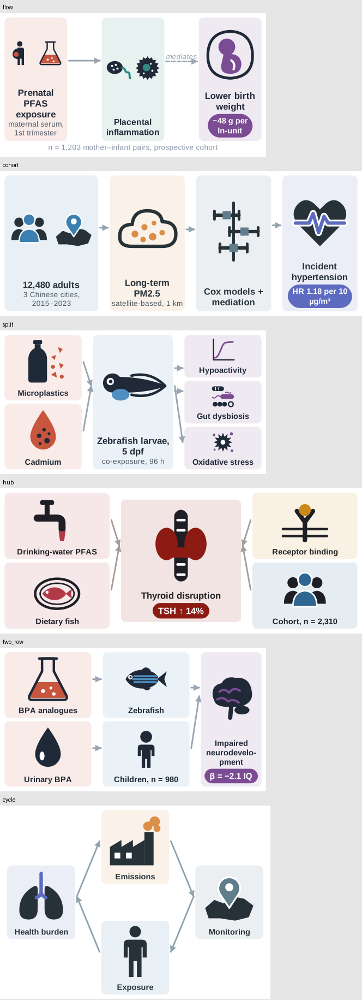

# 课题组工具集：zfbehavior（斑马鱼行为分析）+ tocmaker（SCI TOC 图生成）

## tocmaker / sci-toc — 期刊 TOC 图 / 图文摘要生成器

一份 10 行 YAML → 期刊尺寸的 **SVG（矢量）+ 可编辑 PPTX + 300 dpi PNG/TIFF**，带自动 QA。
面向环境毒理与人群健康论文（ES&T、Environ Int、JHM、STOTEN、EHP、Cell Press、RSC、MDPI…）。

```bash
pip install -e .
python -m tocmaker.cli init --template flow --journal acs -o toc.yaml   # 6 种模板：flow cohort split hub two_row cycle
python -m tocmaker.cli icons search 斑马鱼 placenta cohort                 # 内置 200+ 图标（42 个自绘环境毒理图标 + Health Icons + Bioicons CC0）
python -m tocmaker.cli render toc.yaml -o out --preview --tiff             # out/toc.{svg,pptx,png,pdf,tif} + toc_qa.json
python -m tocmaker.cli presets --all                                       # 39 本期刊的画布规格（tocmaker/db/journal_specs.md）
python -m tocmaker.cli harvest --n 120 --out tocmaker/db/reference         # 采集 OA 文献图文摘要作参考库（需联网 Europe PMC）
```

- 文档与待确认需求：`docs/toc_requirements.md`
- Claude 技能：`.claude/skills/sci-toc/SKILL.md`（说"用 sci-toc 给这段摘要出一张 Environ Int 的 TOC 图"即可）
- 叙事骨架库：`tocmaker/db/patterns.yaml`；示例与效果图：`tocmaker/examples/`（`_gallery.png`）



---

# zfbehavior — 斑马鱼运动行为学视频分析（原型，开发中）

针对幼鱼（多孔板俯视）与成鱼（水箱侧视 / 旷场俯视）运动视频的追踪与指标计算。

**状态：需求已对齐（见 `docs/requirements_and_metrics.md`），P1（96 孔幼鱼明暗场）开发中。**

文档：
- `docs/requirements_and_metrics.md` — 需求、指标清单（商业软件等价 / 扩展 / 姿态级）、分阶段计划、已确认决定
- `docs/hardware_recommendations.md` — 自建幼鱼明暗场小仓（树莓派 + 红外）与平价高速拍摄方案

## 已实现（在合成视频上验证）

- 视频读取、多帧百分位背景建模、背景减除检测（`zfbehavior/tracking.py`）
- 多孔板自动识别（Hough 圆 + 仿射网格拟合）、矩形 / 圆形 / 多边形水槽（`arenas.py`）
- 轨迹清洗：跳变过滤、短间隙插值、平滑、最小移动距离过滤（`postprocess.py`）
- 指标：距离、速度、运动 / 不动、游动片段（bout）、转向、中心 / 外周、上 / 中 / 下层、
  光暗分段、刺激事件响应、群体最近邻距离（`metrics.py`）
- 预设配置：`larva_96well` / `larva_48well` / `larva_24well` / `adult_novel_tank` / `adult_open_field`
- 合成视频生成器（含真值），用于测试（`synthetic.py`）
- EthoVision XT 原始数据导出读取器（`ethovision.py`）与对照验证工具（`compare.py`）

## 已知限制

- 多鱼同框身份跟踪仅为简单匈牙利匹配，鱼体重叠时身份会互换
- 尚无命令行入口、绘图、统计与报告模块
- 尚未在真实视频上测试

## 安装与测试

```bash
python -m venv .venv && .venv/bin/pip install -e ".[dev]"
.venv/bin/python -m pytest -q
```
